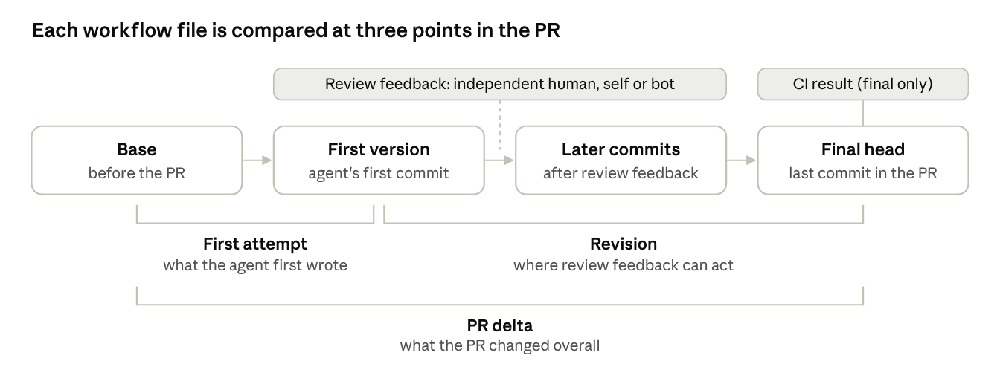
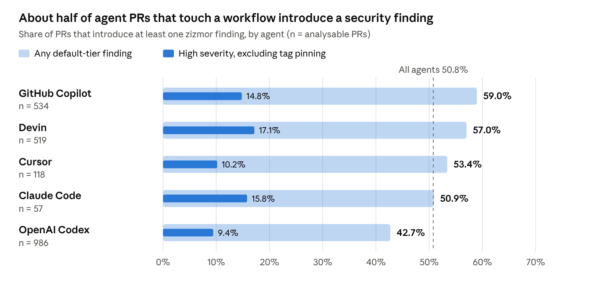
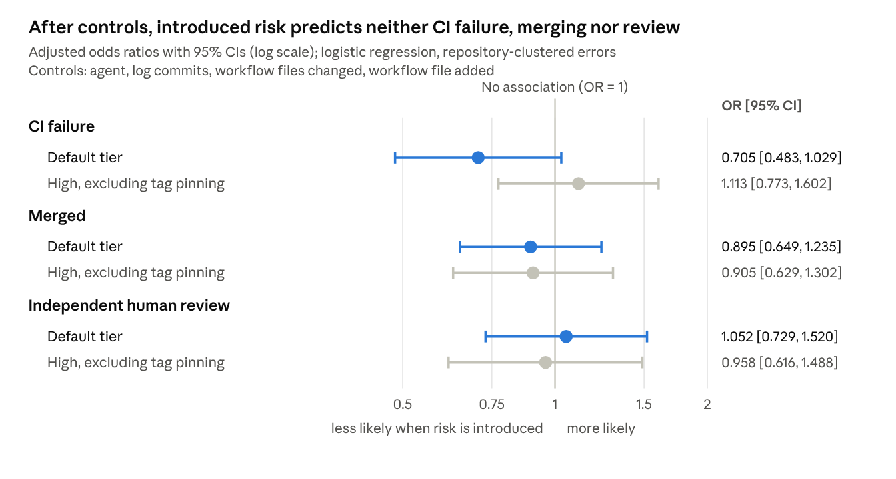
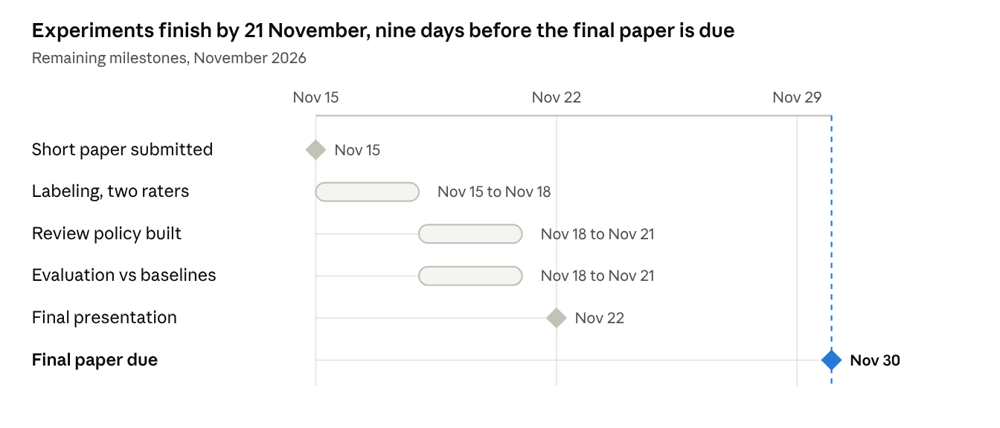

# Beyond Build Success: Security and Human Oversight When AI Agents Change CI/CD Configurations

Khadija Hakim · M. Ali Siddique · Fatima Ghazanfer · Abdullah Qureshi — AI630 Responsible AI, short paper (progress report), 12 November 2026

## Abstract

AI coding agents now open pull requests (PRs) that change continuous integration and delivery (CI/CD) configuration. A recent study reports that such PRs pass their builds about as often as other agent PRs [2]. A passing build, however, does not show that a workflow change is safe, or that anyone checked it. We replicate that study on the same pinned AIDev-pop snapshot and extend it to security and human oversight.

The replication reproduces 65 of 72 published values exactly. It also finds that the published build-success comparison mixes in 5,233 human-written PRs. With agent PRs only, the effect becomes agent-specific: OpenAI Codex PRs that change CI fail 13.5 percentage points more often on their first run.

For the extension, we recovered every revision of every GitHub Actions workflow file in 2,215 of 2,318 agent PRs (95.6%). We scanned each revision with zizmor and actionlint and separated findings the agent introduced from those already present. Preliminary results show that 50.8% of these PRs introduce at least one security finding. After controlling for agent, PR size and repository, introduced risk is not associated with CI failure (OR 0.71, 95% CI 0.48–1.03) or with more human review. 55% of merged PRs had no independent human review. Reporting only introduced findings cuts alert volume by 84%. The remaining work is a manually labeled sample to measure scanner precision, and an explainable review policy evaluated against two baselines.

## 1 Introduction

Autonomous coding agents such as OpenAI Codex, Devin, GitHub Copilot, Cursor and Claude Code now open pull requests on real GitHub projects. The AIDev dataset alone records over 456,000 such PRs across 61,000 repositories [1]. Most of these PRs change application code, but some change the CI/CD configuration that builds, tests and releases the project.

CI/CD configuration is a sensitive target. A GitHub Actions workflow runs with repository tokens and secrets, and it can be triggered by outside contributors. A small change to it can expose credentials or let untrusted input run as code [3]. An agent that edits a workflow therefore changes part of the project's security boundary, not just its build.

Ghaleb [2] gave the first account of how often agents touch CI/CD files and with what outcome. That study found that CI/CD files are a small share of agent changes, that such PRs merge slightly less often, and that their workflow runs succeed about as often as runs of other agent PRs (75.59% vs 74.87%). Build success, however, is a correctness signal. It does not tell a maintainer whether the change weakened the workflow's security, or whether a person reviewed it before merge.

This gap matters from a Responsible AI view. We frame it with four principles: **safety** (does the change introduce risk?), **transparency** (can a reviewer see what the agent changed?), **accountability** (is there a durable record of what happened?) and **human oversight** (did an independent person review it?). Effective human oversight is now a legal requirement for high-risk AI systems in the EU [4]. We use it here as a design principle, not as a legal claim about coding agents.

Our project first replicates Ghaleb's study, then extends it with three research questions:

| RQ | Question | Status |
| --- | --- | --- |
| RQ1–RQ3 | Replication: how often do agents change CI/CD configuration, and how does this relate to merge rate and workflow-run success? | Done |
| RQ4 | Which GitHub Actions security risks do agent PRs introduce, as opposed to risks already present? | Done (preliminary) |
| RQ5 | Are introduced risks associated with CI outcome, merge decision and human review? Do they change between the agent's first attempt and its final revision? | Done (preliminary) |
| RQ6 | Does a revision-aware, explainable review policy surface confirmed risks with fewer irrelevant alerts than scanning the whole file? | Not started |

So far the project contributes: (1) an independent replication on pinned data that reproduces 65 of 72 published values and corrects the build-success conclusion; (2) a revision-aligned dataset of workflow file versions for 2,215 agent PRs, with every scanner finding marked as introduced or pre-existing; (3) preliminary evidence that introduced risks are common, are not caught by CI and are not targeted by review; and (4) evidence that GitHub's CI records for these PRs have already expired, which limits any later audit.

## 2 Related Work

**Agentic pull requests.** Li et al. [1] released AIDev and showed that agent PRs are produced quickly but are accepted less often than human PRs. Peralta et al. [9] inspected 717 closed agent PRs by hand. Only 35.7% of rejections reflected clear agent failures, and 15.4% of merged PRs needed explicit reviewer involvement. A merge label therefore hides much of the human work around an agent PR. We take this as a reason to measure review evidence directly rather than infer it from the merge outcome.

**CI/CD changes by agents.** Ghaleb [2] is our base paper and the only prior study of agent edits to CI/CD configuration. It measures frequency, merge rate and workflow-run success, but not security or review. Ghammam and Almukhtar [6] study build code written by agents and find 364 maintainability and security build smells. They report that more than 61% of agent PRs are merged with minimal human intervention. Their unit is build scripts in general; ours is GitHub Actions workflows tracked revision by revision.

**Security of AI-generated code.** Pearce et al. [5] found that about 40% of programs Copilot completed in security-relevant scenarios were vulnerable. Siddiq et al. [7] identified 1,293 security-related agent PRs in AIDev and found that their rejection depends more on size and verbosity than on security content. Sakib et al. [8] scanned 4,022 AIDev PRs for security smells and found at least one in 38.9% of them, with supply-chain issues making up most findings. This is the closest work to ours, so we do not claim that scanning AIDev for security issues is new.

**GitHub Actions security and alert fatigue.** Koishybayev et al. [3] characterised security weaknesses in GitHub CI workflows at scale, such as broad token permissions and unpinned third-party actions. zizmor [11] and actionlint [12] encode many of these checks as static analysers. Experience at Google shows that developers act on static analysis when results are shown at code review and concern the code being changed [10]. That observation motivates our focus on findings the agent introduced.

**How our work differs.** The table summarises the gap. No prior study links introduced workflow risks to the CI result and the human review recorded at the same revision, and none evaluates a review policy built on that link.

| Study | Agent PRs | Security findings | Introduced vs pre-existing | Per-revision CI and review | Review policy |
| --- | --- | --- | --- | --- | --- |
| Ghaleb [2] | Yes | No | No | CI only, final head | No |
| Ghammam & Almukhtar [6] | Yes | Build smells | Yes, not per revision | No | No |
| Siddiq et al. [7] | Yes | Security-related PRs | No | No | No |
| Sakib et al. [8] | Yes | Security smells | No | No | No |
| Peralta et al. [9] | Yes | No | No | Review rationale | No |
| **This work** | Yes | GitHub Actions (zizmor, actionlint) | Yes | Yes | Planned (RQ6) |

## 3 Dataset

**Base data.** We use AIDev-pop, the curated subset of AIDev that covers popular repositories [1]. We pin the Hugging Face snapshot of 28 October 2025 (commit `4c65121f`), which is the version Ghaleb used. The current release (v5, 7.6 million PRs) gives different numbers, so an unpinned download cannot reproduce the paper. The pinned snapshot holds 33,596 PRs from 2,807 repositories and 711,923 file-change rows, matching the paper exactly. Every downloaded file is checked against a SHA-256 hash.

We also use the base paper's replication package [13] (commit `4ae0b54`). Its CSV of 99,979 GitHub Actions runs (99,930 completed) records the commit each run tested, but only for each PR's final commit.

**Extension cohort.** The extension covers every agent PR in AIDev-pop that changes at least one file under `.github/workflows/`. GitHub Actions accounts for 96.8% of agent CI/CD changes, so this captures nearly all of them. The cohort holds 2,318 PRs from 640 repositories, created between 24 December 2024 and 30 July 2025. In the snapshot, 1,574 were merged, 446 were closed without merge and 298 were still open.

| Agent | PRs | History recovered | Workflow file versions |
| --- | --- | --- | --- |
| OpenAI Codex | 992 | 986 | 4,128 |
| Devin | 570 | 519 | 4,526 |
| GitHub Copilot | 568 | 534 | 4,839 |
| Cursor | 129 | 119 | 933 |
| Claude Code | 59 | 57 | 502 |
| **Total** | **2,318** | **2,215 (95.6%)** | **14,928** |

**Derived data.** For each recovered PR we stored each workflow file at every relevant commit (Section 4). This gave 13,549 file versions across 1,438 distinct workflow paths. A further 1,195 versions are recorded as absent, because the file did not exist at that commit (for example, a workflow the agent created). We also derived, for each version, the CI result of that commit and the review events that came before it.

**Known limits of the data.** The snapshot's commit, review and comment tables are truncated at 30 items per PR, which affects 67 cohort PRs. Our git-based fetch recovers their full commit lists, but some reviews may be missing. CI results exist only for final commits (Section 5.3). We never store usernames; reviewers are kept only as a role. The fetched workflow files have not yet been screened for hard-coded secrets, so we release only aggregate tables for now.

## 4 Methodology

### 4.1 Replication (RQ1–RQ3)

We first ran Ghaleb's scripts unchanged on the pinned data. We then wrote an independent re-implementation in DuckDB that reuses the author's exact file-matching rules but none of the analysis code. We compared every value published in the paper with our output and with the author's own committed result files, at a tolerance of 0.01. Each mismatch was logged and traced to its cause.

For RQ3 (workflow-run success) we also tested the robustness of the published comparison. We restricted it to agent PRs, accounted for runs being grouped within PRs and repositories with generalised estimating equations (GEE), and repeated the test with one observation per PR (its first run), overall and per agent.

### 4.2 Revision alignment

A PR's final diff hides how the agent got there. For each PR and each workflow file it touches, we therefore retrieve three kinds of version: the **base** (before the PR), each **agent commit** that touched the file, and the **final** head. We fetch them with plain `git` from the PR's head ref, so no API token is needed; on a test set the result matched the GitHub API exactly. A PR whose repository is gone, private or rewritten is kept and marked unavailable, not dropped.

From these versions we form three comparisons (Figure 1): the **PR delta** (base to final), the **first attempt** (base to the agent's first version) and the **revision** (first version to final). The revision step is where review feedback can take effect.

*Figure 1. Revision alignment: 4 version types, 3 comparisons per workflow file.* Findings are compared within each bracket. Review events are attributed to the commit that follows them; CI results survive only for the final head.

### 4.3 Scanning and finding identity

Every version is scanned offline with zizmor 1.32.0 [11] for security issues and actionlint 1.7.12 [12] for correctness. We run zizmor in its most inclusive mode and keep each finding's severity and audience level, so stricter views can be derived later. Nothing is executed.

Line numbers shift when an agent edits a file, so we cannot match findings across versions by line. Instead, a finding's identity is its tool, rule, location in the YAML structure and flagged text. Steps are named by their `id`, `name` or action rather than their position, so inserting a step does not make later findings look new. A finding present after a change but not before is **introduced**; the reverse is **fixed**.

We report four nested tiers. **All** is every finding. **Default** is what zizmor shows with standard settings. **High** is default findings rated High. Because the most common finding, an action pinned to a tag rather than a commit hash, is accepted practice in many projects, we also report each tier without it.

### 4.4 CI and oversight evidence

Each version is linked to the CI result of its commit and to the review activity before it. Each review, review comment or PR comment is attributed to one of three roles. An **independent human** is a person other than the PR author. **Self** is the PR author: for Codex, Cursor and Claude Code PRs this is the person who launched the agent, so their reviews do not count as independent oversight. **Bot** covers automated accounts. A missing CI result or review record is coded as unknown, never as absent or successful.

### 4.5 Statistical analysis

We report raw associations with χ² tests. We then fit logistic regressions with standard errors clustered by repository, controlling for agent, the log number of commits, the number of workflow files changed and whether a workflow file was added. The outcomes are merge (closed PRs only), CI failure (PRs with a known final result) and any independent human oversight. All results are associations, not causal effects.

### 4.6 Evaluation plan (RQ6)

Scanner findings are not confirmed vulnerabilities, so RQ6 needs independent ground truth. We will label a stratified sample of about 200 PRs, drawn by agent and finding tier and including PRs without findings so that recall can be measured. Two raters will label each introduced finding as a real risk, a policy-only issue or a false positive, following a written codebook, and we will report Cohen's κ.

On this sample we will compare three ways of directing review: a whole-file scan, an introduced-only scan, and our explainable policy. The policy will route each PR to routine checks, human security review or insufficient evidence, and give a reason for each decision. We will measure precision, recall and F1, and recall when only 20% of PRs can be reviewed. Where the sample allows, we will hold out repositories and time periods and report repository-clustered bootstrap intervals.

## 5 Implementation Progress

The replication and the data side of the extension are complete for the full cohort. This is more than we proposed: our plan was a pilot of 150–200 PRs. The labeling and the review policy (RQ6) have not started.

### 5.1 What is built

The pipeline is written in Python with DuckDB and pandas. Dependencies, including the exact scanner versions, are pinned with `uv`, and each stage re-runs from one command.

| Stage | Output | Status |
| --- | --- | --- |
| Download pinned AIDev-pop snapshot | 33,596 PRs, hash-verified | Done |
| Replicate RQ1–RQ3 and log discrepancies | 65 of 72 values exact; discrepancy log | Done |
| RQ3 robustness re-analysis | GEE and first-run tests, per agent | Done |
| Fetch workflow file versions with `git` | 2,215 PRs; 13,549 versions (about 30 min) | Done |
| Scan with zizmor and actionlint | 254,635 findings, no scanner failures (about 9 min) | Done |
| Match findings across versions | Introduced, fixed and persisting findings per comparison | Done |
| Link CI results and review events | Per-version CI outcome and prior feedback | Done |
| Labeling of about 200 PRs | Labels, Cohen's κ | Not started |
| Explainable review policy and baselines | Precision, recall, F1, recall at 20% budget | Not started |

### 5.2 Technical decisions

- **Pin everything.** The dataset snapshot, the base package commit and the scanner versions are fixed, so another group can reproduce every table.
- **Use `git`, not the GitHub API, for history.** The API's rate limits made a full-cohort fetch slow. Fetching PR head refs with `git` needs no token and matched the API exactly on a test set.
- **Match findings by YAML structure, not line number.** Line-based matching would label most findings in an edited file as new.
- **Record everything, filter later.** Running zizmor in its most inclusive mode lets us derive the default, High and no-pinning tiers from one scan.
- **Separate self-review from independent review.** For three of the five agents the PR author is the person who launched the agent, so counting their activity as review would overstate oversight.

### 5.3 Challenges

- **CI evidence has expired.** We planned to collect the CI result of every agent commit. Runs from December 2024 and July 2025 now return "not found" on GitHub, while runs from December 2025 still exist, which suggests a retention window of about 400 days. Every cohort PR falls outside it. The base package's CSV is now the only surviving record, and it covers only final commits. We therefore know the CI result for 1,574 PRs and treat it as unknown for the other 640. This is also a finding: the audit trail for agent-made CI/CD changes disappears unless someone archives it.
- **Unavailable history.** 82 PRs could not be fetched because the repository was deleted, made private or lost the PR ref, and 21 had rewritten history. We keep them in the cohort as unavailable.
- **Snapshot truncation.** Review tables are capped at 30 items per PR in this snapshot (Section 3).
- **Discrepancies in the base paper.** Several published values could not be reproduced (Section 6.1). We confirmed each against the author's own result files before treating it as an error in the paper rather than in our code.

## 6 Preliminary Results

### 6.1 Replication (RQ1–RQ3)

We reproduced 65 of the 72 values published in the base paper exactly, including every per-agent rate in all three RQs. Our numbers also match the author's committed result files row for row, so the remaining differences lie in the paper's text rather than in either implementation.

| # | Item | Paper | Reproduced |
| --- | --- | --- | --- |
| D1–D2 | Repositories / PRs with YAML changes | 1,605 / 8,031 | 936 / 3,995 |
| D3 | YAML changes per project, mean / median | 17.63 / 3 | 24.74 / 4 |
| D4 | Projects with exactly one YAML PR | 47% | 51.3% |
| D5 | RQ2 overall χ² | 12.95 | 17.42 |
| D6 | RQ2 χ² for OpenAI Codex | 2.91 | 22.91 |
| D7 | Copilot merge-rate advantage | 15.63 pp | 17.75 pp |
| D8 | Share of agent changes that are CI/CD files | 3.25% | 1.10% (3.25% is the YAML share) |

D1–D4 match the author's own script output, not the paper. D5 cannot be obtained from the paper's own 2×2 counts, which we match exactly, and D6 is a dropped digit. None of these changes a published conclusion.

**The build-success conclusion does change.** RQ3 compares workflow runs of PRs that did and did not modify CI. The comparison group, however, contains 24,860 runs from 5,233 human-written PRs. The script cannot check human PRs for CI changes, so it places them all in the "did not modify" group. Human runs succeed far more often (86.7% vs 71.0%), which hides the real comparison.

| Analysis | Modified CI | Did not | Difference |
| --- | --- | --- | --- |
| Published (agent and human runs) | 75.59% | 74.87% | +0.72 pp, p = .138 |
| Agent PRs only, run level | 75.59% | 70.43% | +5.16 pp, p < 10⁻²³ |
| Agent PRs only, runs clustered by PR (GEE) | | | OR 1.07, p = .118 |
| Agent PRs only, first run per PR | 73.65% | 74.92% | −1.27 pp, p = .237 |
| OpenAI Codex, first run per PR | 58.40% | 71.93% | −13.53 pp, p < 10⁻¹³ |
| GitHub Copilot, first run per PR | 81.78% | 76.36% | +5.42 pp, p = .009 |

On agent PRs alone the overall gap is not robust once runs are grouped by PR. The "comparable" overall result therefore stands, but for a different reason, and it hides large opposite effects. Codex PRs that change CI fail much more often on their first run, while Copilot's succeed more often.

### 6.2 Introduced risks (RQ4)

About half of the agent PRs that touch a workflow introduce at least one security finding. Across 2,214 analysable PRs, 50.8% introduce a default-tier zizmor finding and 44.5% a High-severity one. Without the tag-pinning rule, 12.7% still introduce a High-severity finding. Copilot PRs introduce findings most often and Codex PRs least often (Figure 2).

*Figure 2. Source: `results/extension/introduced_by_agent.csv`, 2,214 PRs with recovered history.* The pale bar is any default-tier finding; the dark bar inside it is a High-severity finding other than tag pinning. Codex PRs introduce findings least often, even though Codex has the most PRs.

The most frequent introduced findings are listed below. Several give an attacker a direct route into the pipeline, such as template injection, which lets untrusted text run as a shell command.

| Rule (zizmor) | What it flags | Severity | PRs |
| --- | --- | --- | --- |
| unpinned-uses | Action referenced by tag, not commit hash | High | 923 |
| artipacked | Checkout credentials persisted on the runner | Medium | 658 |
| excessive-permissions | Token permissions broader than needed | Medium | 423 |
| secrets-outside-env | Secret used outside a protected environment | Medium | 275 |
| template-injection | Untrusted input expanded inside a shell step | High | 99 |
| cache-poisoning | Cache that a release job could restore from an untrusted run | High | 83 |
| dangerous-triggers | Trigger that runs with secrets on outside contributions | High | 60 |

Reporting only introduced findings cuts the alerts a reviewer would see from 97,244 to 15,768 (−84%). The median PR goes from 22 alerts to 1. This supports the premise behind RQ6: a reviewer can be shown what the agent changed rather than the file's older warnings.

### 6.3 CI, merge and human review (RQ5)

In raw comparisons, PRs that introduce a default-tier finding fail CI less often (38.4% vs 49.7%), are merged less often (74.6% vs 81.9%) and receive independent human review more often (54.5% vs 38.1%). After controlling for agent, PR size and repository, all three associations disappear (Figure 3). CI does not flag risky workflow changes, and reviewers appear to respond to PR size rather than to the security change itself.

*Figure 3. Source: `results/extension/associations_adjusted.csv`; merge: 1,946 closed PRs; CI: 1,574 PRs with a known result; review: 2,214 PRs.* Every 95% interval crosses 1. The CI estimate for the default tier leans below 1 (OR 0.71), so if anything, risky PRs fail CI slightly less often.

Much of the merged work had no independent oversight at all. Of 1,574 merged PRs, 866 (55.0%) received no review or comment from anyone other than the PR author and bots.

Review feedback is followed by more revision, but not by more targeted revision. Among the 513 PRs that received independent human feedback after the agent's first attempt, 19.1% removed a default-tier finding in a later commit, but 19.7% also added a new one. Among the 1,697 PRs without such feedback, the figures were 7.0% and 6.2%.

## 7 Remaining Work

The main remaining work is RQ6: building labeled ground truth and testing whether an explainable, revision-aware policy directs review better than plain scanning. Figure 4 shows the plan up to the final paper on 30 November.

*Figure 4. Project plan, 15–30 November 2026.*

1. **Labeling (15–18 Nov).** Draw a stratified sample of about 200 PRs by agent and finding tier, including PRs with no findings. Write a codebook that classes each introduced finding as a real risk, a policy-only issue or a false positive. Two members label each PR independently; we report Cohen's κ and resolve disagreements together. This also gives the first estimate of scanner precision, which our current results lack.
2. **Review policy (18–21 Nov).** Implement the policy that routes each PR to routine checks, human security review or insufficient evidence, with a stated reason. For early triage it will use only what is known when the PR is first submitted.
3. **Evaluation (18–21 Nov).** Compare the whole-file scan, the introduced-only scan and the policy on precision, recall, F1 and recall at a 20% review budget, with repository and time holdouts where the sample allows.
4. **If time allows.** Check whether PR descriptions disclose security-relevant workflow changes (transparency), and screen the fetched workflow files for hard-coded secrets so that a redacted dataset can be released.
5. **Final presentation (22 Nov) and final paper (30 Nov).** We still have to choose a CORE A or A* venue and its template.

**Limitations to address in the final paper.** Our findings come from static analysis and are not confirmed vulnerabilities until labeled. The associations are observational, and unmeasured factors such as project maturity may explain part of them. CI results exist only for final commits and are unknown for 640 PRs. The scope is GitHub Actions in public repositories.

## References

[1] H. Li, H. Zhang, and A. E. Hassan. [The Rise of AI Teammates in Software Engineering (SE) 3.0: How Autonomous Coding Agents Are Reshaping Software Engineering](https://arxiv.org/abs/2507.15003). arXiv:2507.15003, 2025.

[2] T. A. Ghaleb. [When AI Agents Touch CI/CD Configurations: Frequency and Success](https://arxiv.org/abs/2601.17413). In *Proc. 23rd International Conference on Mining Software Repositories (MSR)*, 2026. arXiv:2601.17413.

[3] I. Koishybayev, A. Nahapetyan, R. Zachariah, S. Muralee, B. Reaves, A. Kapravelos, and A. Machiry. [Characterizing the Security of GitHub CI Workflows](https://www.usenix.org/conference/usenixsecurity22/presentation/koishybayev). In *Proc. 31st USENIX Security Symposium*, pp. 2747–2763, 2022.

[4] European Parliament and Council of the EU. Regulation (EU) 2024/1689 (Artificial Intelligence Act), [Article 14: Human Oversight](https://artificialintelligenceact.eu/article/14/), 2024.

[5] H. Pearce, B. Ahmad, B. Tan, B. Dolan-Gavitt, and R. Karri. [Asleep at the Keyboard? Assessing the Security of GitHub Copilot's Code Contributions](https://arxiv.org/abs/2108.09293). In *Proc. IEEE Symposium on Security and Privacy (S&P)*, 2022.

[6] A. Ghammam and M. Almukhtar. [AI builds, We Analyze: An Empirical Study of AI-Generated Build Code Quality](https://arxiv.org/abs/2601.16839). arXiv:2601.16839, 2026.

[7] M. L. Siddiq, X. Zhao, V. Carvalho Lopes, B. Casey, and J. C. S. Santos. [Security in the Age of AI Teammates: An Empirical Study of Agentic Pull Requests on GitHub](https://arxiv.org/abs/2601.00477). arXiv:2601.00477, 2026.

[8] A. H. M. N. Sakib, D. Banik, and M. Jadliwala. [Trust but Verify? Uncovering the Security Debt of Autonomous Coding Agents](https://arxiv.org/abs/2607.12428). In *KDD 2026 Workshop on Agentic Software Engineering (AgenticSE)*, 2026. arXiv:2607.12428.

[9] S. R. O. Peralta, F. Hoshi, H. Washizaki, N. Ubayashi, I. Kondo, Y. Higo, H. Mukai, N. Yoshida, K. Kusama, H. Tanaka, and Y. Fan. [Why Are Agentic Pull Requests Merged or Rejected? An Empirical Study](https://arxiv.org/abs/2605.22534). In *Proc. MSR*, 2026. arXiv:2605.22534.

[10] C. Sadowski, E. Aftandilian, A. Eagle, L. Miller-Cushon, and C. Jaspan. Lessons from Building Static Analysis Tools at Google. *Communications of the ACM*, 61(4):58–66, 2018.

[11] W. Woodruff et al. [zizmor: static analysis for GitHub Actions](https://docs.zizmor.sh/), version 1.32.0.

[12] rhysd. [actionlint: static checker for GitHub Actions workflow files](https://github.com/rhysd/actionlint), version 1.7.12.

[13] T. A. Ghaleb. [Replication package for "When AI Agents Touch CI/CD Configurations"](https://github.com/Taher-Ghaleb/AIAgentsCI_CD-MSR2026), commit 4ae0b54.
